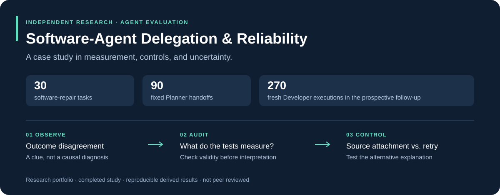
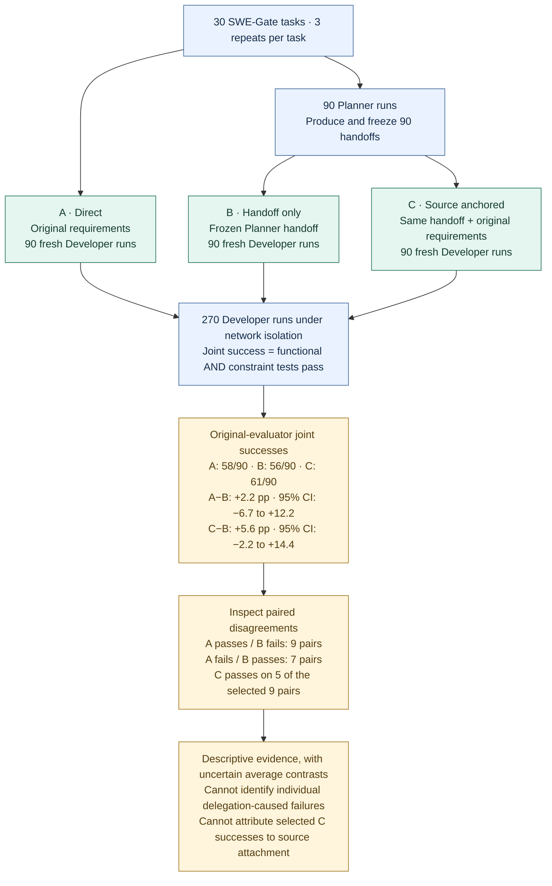
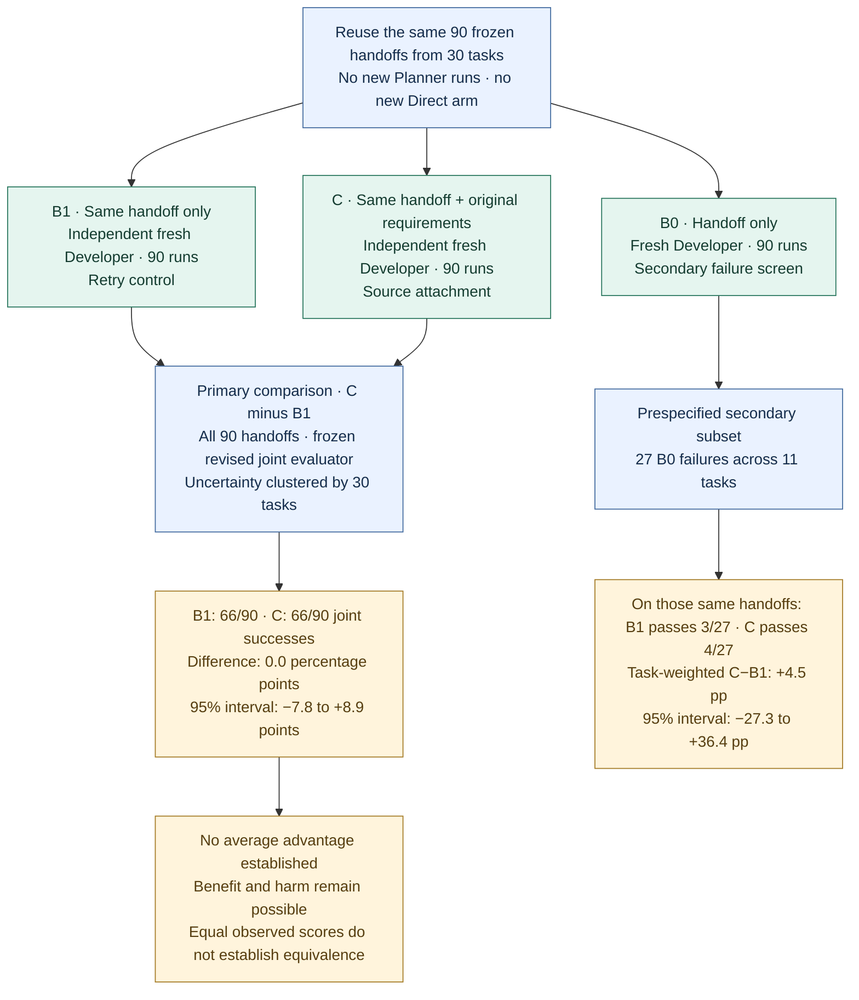

# Does restoring the requirements help an agent—or does trying again help?

An independent research project by **Liming Liu**, exploring requirement fidelity and execution reliability across a Planner–Developer boundary on SWE-Gate.

**The main takeaway:** in a prospective comparison, source attachment and an independent handoff-only retry each achieved **66/90 joint successes**. The task-weighted difference was **0.0 percentage points**, with a **95% task-bootstrap interval of −7.8 to +8.9 points**. This establishes neither an average advantage nor equivalence.

[Research journey](docs/research-journey.md) · [Experimental design](docs/methods.md) · [Results & limits](docs/results.md) · [Lessons learned](docs/reflections.md) · [Technical report](report/research-report.pdf)

> **Project status:** completed research case study and working paper; not peer reviewed. This page emphasizes the research process, including findings that did not support the initial explanation.

## Research at a glance

### 1 · Original study: where do outcomes diverge?

**Question:** how do Developers perform with the original requirements, a Planner handoff, or both?



**Audits between stages:** trajectory inspection identified network access as a potential confound, motivating the isolated Developer runs shown above. Handoff review examined requirement preservation; preservation alone could not establish executability or a purely downstream failure. An evaluator audit then revised constraint rules for 10 tasks and uniformly rescored all 270 archived patches: revised joint successes were **65/90, 63/90 and 67/90** for A/B/C. This was retrospective sensitivity analysis, not new model execution; original scores were retained.

**Why another experiment?** C succeeding after B fails leaves a missing comparison: a fresh Developer given the same handoff might also succeed. The next stage added that control prospectively.

### 2 · Prospective follow-up: does source attachment beat a retry?

**Question:** does giving a Developer the original task requirements improve reliability beyond simply running the same handoff again?



*All three follow-up roles ran for every handoff in randomized order; B0 results only define the secondary analysis subset, not which runs were executed. B0 outputs, patches and results were not passed to B1 or C. “Original requirements” means the task specification; every role could inspect repository code and local tests. The reused task bank is not an independent-task replication, and the two stages' scores use different primary evaluators.*

| At a glance | What the evidence says |
|---|---|
| **What was measured?** | Joint success: both functional tests and task-specific constraint tests pass. |
| **What changed after adding the control?** | Selected source-attached successes could no longer be treated as evidence of causal recovery: independent retries also succeeded. |
| **What remains unresolved?** | Whether source attachment offers a practically useful average benefit; the interval is too wide to establish equivalence. The follow-up did not include a new Direct arm. |
| **What did I learn?** | Build controls that challenge the explanation, audit scoring rules, and let uncertainty narrow the claim. |

The sections below explain the design, research decisions, results and limitations in detail.

## The question

A Planner reads a software task and hands instructions to a fresh Developer. If the Developer fails, did the handoff lose something important—or did a new execution simply go wrong?

An initially appealing observation was **Direct succeeds → Handoff-Only fails → Source-Anchored succeeds**. But separate model runs can disagree. A later success alone does not show that restoring source requirements caused recovery.

The project investigated this alternative explanation rather than treating the selected successes as proof of a mechanism.

## How the study evolved

| Stage | What was done | Why it mattered |
|---|---|---|
| **Observe** | Compared Direct, Handoff-Only and Source-Anchored Developers on 30 tasks and 90 frozen handoffs; repeated Developer execution under network isolation after a trajectory audit | Recorded outcome disagreement while addressing a potential environment confound |
| **Audit** | Examined constraint evaluators, validated revised rules for 10 tasks, and uniformly rescored all 270 archived isolated-study patches | Exposed implementation-sensitive scoring; preserved original scores and treated revisions as retrospective sensitivity analysis |
| **Control** | Completed a locally frozen, prospective 270-run B0/B1/C follow-up on the same handoff bank | Compared source attachment with an independent retry, rather than with a run already selected for failure |

The phases remain separate. Rescoring old patches was **not** a new model experiment, and reusing the task bank was **not** independent-task replication.

## The missing control

| Follow-up role | Developer input | Purpose |
|---|---|---|
| **B0 — Screen** | Frozen handoff only | Defines a prespecified secondary failure subset |
| **B1 — Retry** | The identical handoff-only prompt, in a fresh execution | Measures fresh-run performance without source attachment |
| **C — Source anchored** | The same handoff plus the original issue and constraint | Tests whether source attachment improves performance relative to B1 |

All three roles ran for every handoff, with randomized execution order. B0 outputs, patches and results were **not passed to B1 or C**. The primary comparison used the **whole fixed handoff bank**, not only B0 failures.

Here, “source” means the original **task specification**, not source-code access. Every role could inspect the repository and local tests, including when the handoff was empty.

## What the follow-up found

Joint success requires both functional and constraint tests to pass under the frozen revised evaluator.

| Outcome | B0: screen | B1: retry | C: source anchored |
|---|---:|---:|---:|
| **Joint success** | **63/90** | **66/90** | **66/90** |
| Functional success | 73/90 | 77/90 | 77/90 |
| Constraint success | 71/90 | 71/90 | 71/90 |

**Primary estimate: C − B1 = 0.0 pp; 95% CI [−7.8, +8.9] pp**, using 100,000 task-bootstrap resamples across 30 task clusters.

- **Supported:** no average source-anchoring advantage was established in this task bank and configuration.
- **Unresolved:** the interval permits benefit and harm; it does not demonstrate no effect or equivalence.
- **Secondary:** among 27 B0-failure handoffs from 11 tasks, B1 succeeded on 3 and C on 4. The task-weighted contrast remained highly uncertain.
- **Beyond scope:** individual causal failure/recovery, a general safety guarantee, or a new Direct-versus-Delegated estimate. The follow-up had no contemporaneous Direct arm.

[See all stages, denominators and limitations →](docs/results.md)

## What I learned about research

**Choose the control that can challenge the explanation.** A failed run followed by a successful one is not sufficient evidence that an intervention worked. Adding the retry control changed the question the data could answer.

**Audit the measurement before interpreting the score.** Some constraint tests were sensitive to local identifier names. That finding motivated a separately reported evaluator sensitivity analysis—not a claim that every failed patch was correct.

**Let uncertainty change the conclusion.** The project moved from an attractive causal story to a narrower, auditable account of discordance, evaluation validity and an inconclusive average contrast. Completing the protocol and reporting that uncertainty was part of the work.

These lessons inform my interest in **Reliable Autonomous Agents** and **Agent Safety Evaluation**. This project concerns software-agent reliability and evaluation methodology; it does not establish runtime safety guarantees or equate all software constraints with safety properties.

[Read the research reflections →](docs/reflections.md)

## Reproduce the derived results

Python 3 and its standard library are sufficient. **No API key, Docker or paid model calls are required.**

```bash
python3 scripts/reproduce.py
```

The script checks the primary and secondary contrasts, task-bootstrap intervals, counts, repeat discordance and conservative accounting against the completed frozen analysis. It reproduces **analysis from derived outcomes**, not model generations or evaluator execution.

[Reproduction details](docs/reproducibility.md) · [Derived outcomes](data/outcomes.csv) · [Expected results](data/expected-results.json)

## Contribution and evidence boundaries

Scientific failures and valid resource-limit exits were retained. Infrastructure-invalid attempts were archived under recorded rules, including exclusion of the entire pre-output-limit-fix cohort. 

The technical report is optional supporting material. The project can be read as a research case study without treating it as a published paper.

**Benchmark:** [SWE-Gate](https://arxiv.org/abs/2609.04167). Raw requirements, handoffs, trajectories, patches, credentials and private review inputs are not part of the curated portfolio export. Original research records remain in the local audit workspace.
